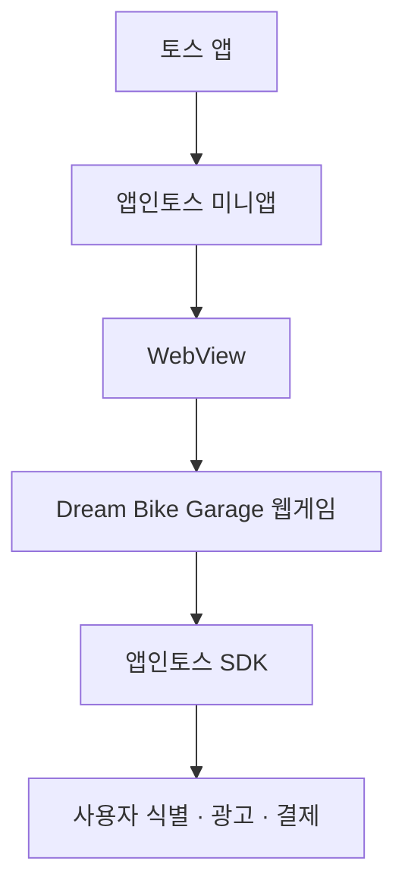

# 앱인토스 WebView 안내 및 적용 방안

> 대상 프로젝트: **Dream Bike Garage (오늘부터 자전거 부자)**  
> 문서 목적: 웹 MVP를 앱인토스(Apps in Toss)에서 출시하기 위한 공통 이해와 개발 기준을 정리한다.  
> 최종 업데이트: 2026-10-29 — 출시 빌드(main `fb5f113`과 광고 충전 이벤트 기록 #113) 기준으로 저장·식별(6절 4단계, 7절), 첫 출시 범위(8절), 보안(10절), 체크리스트(12절), 콘솔·등급분류 현황(13절)을 갱신했다. 처음 작성 2026-08-26

## 1. 결론

Dream Bike Garage는 **Vite + TypeScript + Phaser 기반 웹게임을 유지하고, 앱인토스 WebView SDK를 연결하는 방식**을 우선 채택한다.

이 방식은 현재 머지 코어와 UI를 대부분 재사용하면서 토스 앱 안에서 설치 없이 실행할 수 있다. GitHub Pages는 개발 확인과 웹 체험판 용도로 유지하고, 앱인토스에는 SDK를 적용한 별도 빌드 결과물을 등록한다.

## 2. 앱인토스란?

앱인토스는 외부 서비스나 게임을 토스 앱 안에서 실행할 수 있게 해주는 미니앱 플랫폼이다. 파트너는 앱인토스 SDK를 연동한 빌드 결과물을 콘솔에 업로드하고 검수를 거쳐 출시한다.

Dream Bike Garage 관점의 역할은 다음과 같다.

- 별도 앱 설치 없이 토스 안에서 게임 실행
- 기존 웹게임 소스 재사용
- 토스가 제공하는 사용자 식별, 광고, 결제, 프로모션 등의 기능을 SDK로 연결
- 앱인토스 콘솔에서 앱 정보, 빌드, 검수 및 출시 관리

## 3. WebView란?

WebView는 **모바일 앱 내부에서 웹 콘텐츠를 실행하는 브라우저 영역**이다. 사용자는 토스 앱 안에서 게임을 이용하지만, 게임 화면과 로직은 HTML, CSS, JavaScript로 동작한다.



일반 브라우저와 달리 주소창이 없고 앱 화면처럼 보인다. 토스 기능은 웹 코드에서 직접 사용하는 것이 아니라 앱인토스 SDK를 통하여 호출한다.

## 4. 현재 프로젝트에 적합한 이유

- 2D UI 중심의 캐주얼 머지게임이므로 WebView에서 구현하기 적합하다.
- 기존 Vite, TypeScript, Phaser 코드와 게임 데이터를 재사용할 수 있다.
- 주문 → 부품 생성 → 머지 → 조립 → 납품 → 급여 획득의 짧은 플레이 루프가 미니앱 이용 방식과 잘 맞는다.
- GitHub Pages와 앱인토스 버전이 동일한 게임 코어를 공유할 수 있다.
- 향후 Google Play 독립 앱을 준비하더라도 웹 코어와 플랫폼 연결 계층을 분리해 재사용할 수 있다.

## 5. 적용 구조

```text
src/
├─ core/                 # 머지, 주문, 조립, 보상 규칙
├─ game/                 # Phaser 화면과 입력 처리
├─ data/                 # 부품, 자전거, 주문 데이터
├─ platform/
│  ├─ web/               # 브라우저·GitHub Pages 구현
│  └─ apps-in-toss/      # 앱인토스 SDK 어댑터
└─ storage/
   ├─ local/             # 개발·웹 체험판 저장
   └─ remote/            # 출시용 서버 저장
```

게임 로직에서 SDK를 직접 호출하지 않고 플랫폼 인터페이스를 둔다.

```ts
interface GamePlatform {
  getUserId(): Promise<string | null>
  saveProgress(data: GameProgress): Promise<void>
  loadProgress(): Promise<GameProgress | null>
  showRewardedAd(): Promise<boolean>
  purchase(productId: string): Promise<PurchaseResult>
  haptic(type: "light" | "success"): Promise<void>
}
```

웹에서는 빈 구현 또는 테스트 구현을 사용하고, 앱인토스 빌드에서만 실제 SDK 어댑터를 주입한다. 광고나 결제를 붙이지 않은 첫 출시에서도 이 구조를 먼저 만들어 두는 것이 좋다.

> 2026-10-29 실제 적용: 위 폴더 구조와 인터페이스는 8월 제안안이다. 출시 빌드는 `src/domain`(규칙)·`src/data`(데이터)·`src/game`(화면)·`src/platform`(플랫폼 어댑터와 저장)으로 나뉜다. 플랫폼 인터페이스는 `src/platform/types.ts`의 `GamePlatform`(저장소·사용자 키·앱 전환·뒤로가기·닫기·진동·Safe Area·세로 고정·보상형 광고·분석 이벤트 기록 `logEvent`)이고, 결제는 없다. 상세는 [앱인토스 SDK 설정 3절](APPS_IN_TOSS_SDK_SETUP.md)을 본다.

## 6. 개발 및 출시 절차

### 1단계 — 웹 MVP 완성

- 주문별 필요 부품 표시
- 부품 생성과 동일 부품 2-to-1 머지
- 부품을 이용한 자전거 조립
- 제한 시간, 주문 성공·실패, 급여 보상
- 새로고침 후 진행 상태 복원
- 모바일 터치 입력 안정화

### 2단계 — 모바일 WebView 대응

> 화면 셸 구성(웹 쇼케이스/앱 풀스크린 모드), 기준 해상도, Safe Area 처리의 상세 기준은 [SCREEN_LAYOUT_STRATEGY.md](SCREEN_LAYOUT_STRATEGY.md)를 따른다.

- 세로 화면을 기본으로 설계
- `safe-area-inset-top/bottom`을 반영해 노치와 홈바 영역 보호
- 마우스 이벤트보다 Pointer Event 또는 터치 입력 우선 사용
- 브라우저 기본 스크롤, 확대, 길게 누르기 동작이 게임 조작과 충돌하지 않도록 처리
- 토스의 뒤로 가기와 게임 내 닫기·일시정지 정책 정의
- 백그라운드 전환, 종료 직전, 주문 상태 변경 시 자동 저장
- 저사양 기기에서 프레임, 메모리, 발열 확인

### 3단계 — 앱인토스 SDK 연동

- 앱인토스 개발자 콘솔에서 워크스페이스와 게임 등록
- 기존 웹 프로젝트용 WebView 개발 가이드에 따라 SDK 구성
- `apps-in-toss.config.ts`의 앱 이름을 콘솔 정보와 일치 (SDK 3.x 형식. 2.x는 `granite.config.ts`)
- 로컬(devtools) 및 토스 앱 테스트 QR로 실행 확인
- 적용 내역과 명령: [앱인토스 SDK 설정과 화면 맞춤](APPS_IN_TOSS_SDK_SETUP.md)
- 앱인토스 기능은 플랫폼 어댑터를 통하여 연결

> 패키지명과 SDK API는 변경될 수 있으므로 구현 시점의 공식 가이드를 기준으로 설치한다.

### 4단계 — 사용자 식별과 저장

> 2026-10-29 현재: **첫 출시 빌드에는 서버가 없다.** 8월에 정한 '서버 저장'은 적용하지 않았고, 진행은 기기 저장소의 계정 슬롯에 둔다.

| 항목 | 출시 빌드 |
|---|---|
| 사용자 식별 | 로그인 화면 없이 `User.getAnonymousKey()` 해시로 저장 슬롯만 나눈다. 토스앱 5.232.0 미만이거나 오류면 기기 공용 슬롯 `local`을 쓰고, 다음 실행에서 키를 받으면 그 슬롯으로 한 번 옮긴다. SDK 3.x의 `getUserKeyForGame`은 이 함수의 v2 호환 별칭(지원 중단)이다 |
| 저장소 | 앱인토스: 토스 `Storage`(기기의 저장소, 비동기·문자열 전용). 웹·안드로이드 테스트 앱: localStorage |
| 저장 키 | `dbg:v1:{사용자 키 또는 local}:{항목}` |
| 저장 항목 | `release`(코인·Day·작업대·대회·광고 충전 기록·설정), `collection`(도감·보유·제작·대표·전시), `growth`(자전거별 강화) |
| 방식 | 시작할 때 슬롯을 한 번에 읽어 메모리에 올리고, 쓰기는 순서대로 내보낸다. 저장에 실패해도 메모리 진행은 유지한다 |

코드는 `src/platform/save-store.ts`, 상세는 [앱인토스 SDK 설정 3절](APPS_IN_TOSS_SDK_SETUP.md)에 있다.

#### 서버가 없어서 생기는 알려진 제한

- **토스 앱을 지우면 진행도 지워진다.** 공식 [스토리지 문서](https://developers-apps-in-toss.toss.im/documentation/common/file-storage/storage.html)가 "토스 앱을 삭제하면 저장소에 저장된 데이터도 함께 삭제돼요."라고 안내한다. 사용자 키는 앱을 지우거나 기기를 바꿔도 같은 값이지만, 저장소가 비어 처음부터 다시 시작한다.
- **기기를 바꾸면 진행이 따라오지 않는다.** 공식 문서는 `Storage`를 모바일 앱의 로컬 저장소로 설명한다(실기기로 확인하지는 않음).
- **환경끼리 진행이 이어지지 않는다.** 웹(GitHub Pages)·안드로이드 테스트 앱·앱인토스는 저장소가 따로다.
- **잃어버린 진행을 되살려 줄 방법이 없다.** 서버에 기록이 없어 문의가 와도 복구할 수 없다.
- **코인·보상을 서버에서 검증하지 않는다.** 결제나 현금성 보상이 없어 영향은 한 사람의 진행 안에 머문다(10절).

공식 문서는 게임 세이브 데이터를 사용자 키 기준으로 관리하도록 권장하고([사용자 식별키 발급](https://developers-apps-in-toss.toss.im/user-hash-key/develop.html)), 출시 빌드는 저장 슬롯을 이 키로 나눠 따른다. 다만 저장 위치가 기기라 위 제한이 남는다. 이 제한은 [출시 계획](RELEASE_PLAN_2026_11.md) S14의 '알려진 제한 사항' 후보이며, 서버 저장을 언제 도입할지는 **기획 확정 대기**다.

나중에 서버 저장을 붙일 때의 대상(8월 계획):

- 보유 재화와 급여
- 드림 바이크 성장 상태
- 진행 중인 주문과 완료 기록
- 부품 및 자전거 컬렉션
- 광고 보상 수령 기록
- 구매 상품과 지급 이력

서버를 두면 클라이언트가 보낸 재화·보상 결과를 그대로 신뢰하지 않고 서버에서 검증한다.

### 5단계 — 검수 준비와 출시

- 아이콘, 대표 이미지, 게임 설명 및 이용 방법 준비
- 이용약관, 개인정보처리방침, 고객 문의 방법 연결
- 로딩, 네트워크 오류, 점검, 서버 장애 화면 준비
- 사운드·효과음·진동의 켜기/끄기 제공
- 게임 출시 체크리스트에 따라 실제 기기 점검
- 앱인토스용 빌드 결과물을 콘솔에 업로드
- 앱 정보 및 빌드 검수 요청
- 승인 후 콘솔에서 출시

## 7. 플랫폼별 빌드 운영

| 구분 | GitHub Pages | 앱인토스 |
|---|---|---|
| 목적 | 개발 확인, 웹 체험판 | 모바일 정식 출시 |
| 실행 환경 | 일반 브라우저 | 토스 앱 내부 WebView |
| 빌드 | 기본 Vite 빌드(`npm run build`) | 앱인토스 SDK 적용 빌드(`npm run build:toss`) |
| 사용자 식별 | 없음(기기 공용 슬롯 `local`) | `User.getAnonymousKey()` 해시(받지 못하면 `local`) |
| 저장 | localStorage 계정 슬롯 | 토스 `Storage` 계정 슬롯. 기기 저장이며 서버는 없음(6절 4단계) |
| 광고·결제 | 광고·결제 없음(개발 서버와 `?mockAd` 주소에서만 모의 광고) | 보상형 광고 체력 충전. 광고 그룹 ID가 없으면 공식 테스트 ID로 빌드되고, 운영 ID는 운영 번들에만 넣음. 결제 없음 |
| 배포 | main 머지 후 Actions | 콘솔 업로드(`npm run deploy:toss`)·검수·출시 |

환경별 코드를 복사하지 말고 환경 변수와 플랫폼 어댑터로 구분한다.

## 8. 첫 출시 범위

첫 출시의 목표는 **게임의 재미와 플레이 지속 여부 검증**이다.

> 2026-10-29 갱신: 출시 빌드(main `fb5f113`과 #113)에 실제로 들어 있는 범위다. 8월 계획과 비교하면 레이스와 보상형 광고 체력 충전이 들어왔고, 서버 저장은 없으며, 플레이 이벤트는 보상형 광고 충전 흐름만 기록한다. 게임 범위 상세는 [MVP 범위](../game-design/MVP.md)를 따른다.

포함:

- 핵심 주문형 머지 플레이: 머지 작업대 E안(6×7 보드, 자동 입고·인접 합성·자동 장착), 주문 3건 = 하루 일정, 영업일 주문표
- 알바 체력(최대 30, 상자당 1, 10분당 1 회복)
- 보상형 광고 체력 충전(사용자가 고르는 보상, 앱인토스 빌드만)
- 자전거 제작·강화와 대표 자전거(8월 계획의 '드림 바이크 1대 성장'이 도감 자전거 전체로 넓어짐)
- 컬렉션: 도감 24대, 전시대 3칸, Garage 효과
- 5일 주기 대회(리버사이드 3K 챌린지 자동 레이스, 참가비·상금)
- 사용자 식별키로 나눈 기기 저장(서버 없음, 6절 4단계)
- 프롤로그, 튜토리얼(첫 플레이 안내), 설정, 오류 안내
- 플레이 이벤트 수집 중 보상형 광고 충전 흐름(`ad_refill_*` 8종, [#113](https://github.com/aigemro/dream-bike-garage/pull/113)): 앱인토스에서 SDK `Analytics.log`로 보내고, 웹·안드로이드 테스트 앱은 개발 서버 콘솔에만 찍는다. 이벤트·파라미터는 [머지 작업대·Day 세션 9절 '이벤트 기록'](MERGE_WORKBENCH_DAY_SESSION.md), SDK 연결은 [앱인토스 SDK 설정 3절 '분석 이벤트 기록'](APPS_IN_TOSS_SDK_SETUP.md)

8월 계획에 있었지만 출시 빌드에 없는 것:

- 서버 저장(6절 4단계)
- 그 밖의 플레이 이벤트 수집: 광고 충전 흐름 밖(9절의 지표)을 기록하는 코드가 없다

제외 또는 후속 검토:

- 강제 전면 광고
- 인앱 결제
- 토스 포인트 프로모션
- 실제 글로벌 브랜드와 로고
- 대리점 쿠폰, 시승 예약 및 O2O
- 매치3, 복잡한 경영 시스템
- 레이스 확장(레이스 비교안, 세계 코스, 등급 리그)

보상형 광고는 **사용자가 선택하는 보상**으로 첫 출시에 넣었다. 체력 20 이하일 때 광고 1회에 체력 +10이며, 2026-10-18부터 하루 횟수·충전 간격 제한이 없다([#92](https://github.com/aigemro/dream-bike-garage/issues/92) 본문의 하루 3회·10분 간격과 다름). 운영 광고 그룹 ID 설정, 토스 실기기 검증, 앱인토스 광고 운영 정책(빈도·횟수 상한) 확인이 남아 있다([머지 작업대·Day 세션 9절](MERGE_WORKBENCH_DAY_SESSION.md)).

## 9. 측정할 지표

- 게임 실행 및 로딩 완료율
- 튜토리얼 완료율
- 첫 주문 완료율
- 주문 성공·실패 비율
- 세션당 주문 수
- 세션 길이
- 1일·7일 재방문율
- 머지 단계별 이탈 지점
- 오류율과 강제 종료율

이벤트 이름과 속성은 개발 전에 문서화하고, 개인정보를 이벤트 값에 포함하지 않는다.

> 2026-10-29: 출시 빌드는 보상형 광고 충전 흐름 이벤트만 기록한다([#113](https://github.com/aigemro/dream-bike-garage/pull/113), [머지 작업대·Day 세션 9절 '이벤트 기록'](MERGE_WORKBENCH_DAY_SESSION.md), [앱인토스 SDK 설정 3절 '분석 이벤트 기록'](APPS_IN_TOSS_SDK_SETUP.md)). 위 지표는 아직 기록 코드가 없어 모을 수 없다(8절). 앱인토스 콘솔 **분석 > 이벤트**는 출시 다음 날부터 집계한다.

## 10. 보안과 운영 주의사항

> 2026-10-29: 첫 출시 빌드에는 서버가 없다(6절 4단계). 서버 관련 항목은 서버를 붙일 때의 기준으로 두고, 지금 빌드의 상태를 '현재'로 함께 적는다.

- 게임 재화, 보상, 구매 결과는 서버에서 검증한다.
  - 현재: 서버가 없어 코인·보상을 클라이언트에서 계산해 기기 저장소에 둔다. 결제나 현금성 보상(토스 포인트 프로모션 등)을 붙이기 전에 서버 검증을 먼저 둔다.
- 사용자 식별키와 서버 비밀키를 클라이언트 저장소에 노출하지 않는다.
  - 현재: 서버 비밀키는 없다. 익명 사용자 키 해시는 기기 저장소의 저장 키 이름(`dbg:v1:{해시}:…`)에 들어간다. 이 규칙과 맞는지 검수 요청 전에 확인한다.
- 결제·광고·프로모션은 각각의 최신 검수 및 운영 정책을 확인한다.
  - 현재: 보상형 광고가 들어갔으므로 광고 운영 정책을 출시 전에 확인한다(8절).
- WebView에서 외부 링크를 열 때 허용 도메인과 이동 방식을 제한한다.
- 네트워크 재시도 때문에 보상이 중복 지급되지 않도록 요청 식별자와 멱등 처리를 사용한다.
  - 현재: 보상형 광고는 요청마다 식별자를 만들고, 마지막으로 보상한 식별자와 같으면 반영하지 않는다(`grantAdRefill`, `src/domain/energy-refill.ts`).
- 데이터 초기화, 문의, 장애 공지와 서비스 종료 절차를 마련한다.
  - 현재: 데이터 초기화는 설정 화면에 있다(2단계 확인).

## 11. 기존 브랜드 기획서 활용 기준

첨부된 「글로벌 자전거 브랜드 게임 마케팅 기획서」에는 브랜드 컬렉션, 매치3, 레이스, O2O, 과금 모델이 제안되어 있다. 이는 현재 MVP의 필수 범위가 아니라 **향후 확장 아이디어**로 관리한다.

특히 실제 브랜드명, 모델명, 로고, 팀 에디션을 서비스에 노출하려면 라이선스와 상표권 검토가 선행되어야 한다. 첫 출시에서는 가상 브랜드와 자체 디자인을 사용한다.

현재 우선순위는 다음과 같다.

1. 주문형 머지 코어의 재미
2. 모바일 터치와 한 화면 UI
3. 안정적인 저장 및 복구
4. 앱인토스 검수 통과
5. 사용자 데이터 기반의 기능 확장

## 12. 출시 전 체크리스트

> 2026-10-29: [#79](https://github.com/aigemro/dream-bike-garage/issues/79)에서 확인된 항목만 체크했다. 마지막 콘솔 업로드가 2026-10-09 main `8cf2d36`이라, 그 뒤에 들어온 변경(출시 화면 디자인 정리·영업일 주문표·합성 추천·보상형 광고 충전과 이벤트 기록·체력 소진 카드·프롤로그·합성 보너스·대회일 참가 질문·Garage 효과)은 실기기에서 확인하지 않았다.

### 게임

- [ ] 주문 → 생성 → 머지 → 조립 → 납품 → 급여 루프가 끝까지 동작한다.
- [ ] 보드가 가득 찬 경우와 체력 소진이 처리된다. (출시 빌드에는 제한 시간이 없어 '제한 시간 종료'를 '체력 소진'으로 바꿈)
- [ ] 터치가 스크롤이나 확대 동작과 충돌하지 않는다.
- [ ] 작은 화면에서도 아이템과 주문 조건을 식별할 수 있다.
- [ ] 백그라운드 전환과 재실행 후 진행 상태가 복원된다.

### 앱인토스

- [x] 콘솔 정보와 앱 설정이 일치한다. — appName `dream-bike-garage`로 콘솔 업로드와 토스 앱 실행을 확인(2026-10-09)
- [ ] 샌드박스 및 실제 기기에서 테스트했다. — 부분: SDK 3.x에는 샌드박스 앱이 없어 devtools(`npm run dev:toss`)로 확인했고, 휴대폰의 토스 앱에서 실행·플레이를 확인(2026-10-09, 기기·OS 미기록). 항목별 결과는 기록 전
- [ ] 뒤로 가기, 닫기, 로딩, 오류, 점검 화면이 동작한다. — 뒤로가기·종료 확인 창은 구현(#82), 실기기 미확인
- [ ] 사용자 식별키 슬롯 저장과 재실행 복구를 실기기에서 검증했다. (서버 저장은 없음, 6절 4단계) — 웹과 devtools에서만 확인(#81)
- [ ] 게임 출시 가이드와 공통 정책을 확인했다. — 게임 체크리스트 항목은 코드로 대응(#82), 항목별 실기기 결과는 기록 전
- [ ] 아이콘, 설명, 약관, 개인정보처리방침, 문의 경로를 준비했다.
- [ ] 승인된 빌드만 출시한다.

## 13. 앱인토스 콘솔 등록 및 출시 준비 현황

> 기준일: **2026-10-29** (처음 작성 2026-08-26) · 근거: [#79](https://github.com/aigemro/dream-bike-garage/issues/79) 진행 댓글(2026-10-09), README의 앱인토스 테스트 QR 기록

> [!IMPORTANT]
> 2026-10-09에 앱인토스 SDK 3.8.0을 적용하고, 콘솔에 테스트 번들을 올려 휴대폰의 토스 앱에서 실행되는 것까지 확인했다.  
> 게임 등급분류(GRAC) 신청과 콘솔 검토 요청은 아직 하지 않았다. 마지막 업로드(main `8cf2d36`) 뒤에 들어온 기능은 실기기에서 확인하지 않았다.

### 13.1 현재 상태 요약

| 구분 | 상태 | 비고 |
|---|---|---|
| 콘솔 기본 정보 | 입력 완료 | 한국어·영어 앱 이름, 부제, 상세 설명, `appName`, 고객문의 정보 |
| 카테고리·검색 정보 | 입력 완료 | 게임 카테고리와 앱 검색 키워드 설정 |
| 노출 이미지 | 등록 준비 | 로고, 다크모드 로고, 썸네일, 세로·가로 스크린샷 |
| 콘솔 저장 상태 | 임시저장 완료 | 등급분류 신청 전 단계까지 작성 |
| 앱인토스 실행환경 | **적용 완료** (2026-10-09) | SDK `@apps-in-toss/web-framework` 3.8.0. 빌드 분리, 플랫폼 어댑터, 계정 슬롯 저장, 출시 체크리스트 대응(#80·#81·#82). 상세: [앱인토스 SDK 설정](APPS_IN_TOSS_SDK_SETUP.md) |
| 콘솔 API 키 | 발급·개발 PC 등록 | `npx ait token add`. 테스트 후 재발급 권장(#79) |
| 테스트 업로드 | 1회 (2026-10-09) | main `8cf2d36`, `.ait` 약 437KB. 그 뒤 들어온 출시 화면 디자인 정리(#87)·영업일 주문표·합성 추천·보상형 광고 충전과 이벤트 기록(#113)·체력 소진 카드·프롤로그·합성 보너스·대회일 참가 질문·Garage 효과는 아직 올리지 않음 |
| 실기기 확인 | 부분 | 휴대폰의 토스 앱에서 실행·플레이를 확인(2026-10-09). 기기·OS·토스 앱 버전과 항목별 결과(첫 화면 10초 이내, 주문 1건 완주 = M3, 재실행 복구, 뒤로가기, 앱 전환 시 소리, 진동)는 기록 전 |
| 게임 등급분류 | 신청 전 | GRAC 직접 신청, 보통 10~15일. 주요 화면 확정 후 신청(13.3) |
| 다음 작업 | 진행 예정 | 최신 main 재업로드 → 실기기 항목별 확인(M3) → 주요 화면 확정 → GRAC 신청 |

콘솔 기본 정보·카테고리·노출 이미지·콘솔 저장 상태는 2026-08-26 기록 그대로다(이후 갱신 기록 없음).

### 13.2 콘솔 등록 및 노출 자산 준비 내역

#### 기본 정보

- 한국어 앱 이름 등록
- 영어 앱 이름 등록
- 부제 및 상세 설명 작성
- `appName`: `dream-bike-garage`
- 고객문의 정보 입력

#### 카테고리 및 노출 정보

- 게임 카테고리 설정
- 앱 검색 키워드 설정
- 아래 규격에 맞춘 노출 이미지 등록 준비

| 자산 | 규격 | 수량 | 현재 상태 |
|---|---:|---:|---|
| 앱 로고 | 600×600 | 1장 | 등록 준비 |
| 다크모드 앱 로고 | 600×600 | 1장 | 등록 준비 |
| 썸네일 | 1932×828 | 1장 | 등록 준비 |
| 세로형 스크린샷 | 636×1048 | 최소 3장 | 등록 준비 |
| 가로형 스크린샷 | 1504×741 | 최소 1장 | 등록 준비 |

### 13.3 게임 등급분류 진행 기준

앱인토스 콘솔에서 게임 등급분류 단계까지 진입했지만, **현재는 등급분류를 신청하지 않는다.**

등급분류를 받은 게임과 실제 앱인토스 출시 게임의 주요 내용·화면이 일치해야 한다. 현재 일반 프로젝트에는 MVP 개발과 앱인토스 출시 대응 작업이 남아 있으므로, 개발 중인 화면과 기능을 기준으로 먼저 신청하면 등급분류 자료와 최종 출시본 사이에 차이가 생길 수 있다.

따라서 **MVP 핵심 흐름이 최종 동작하고 앱인토스용 주요 화면이 확정된 이후** 게임물 등급분류를 신청한다.

등급분류 완료 후 발급·확정된 실제 정보를 기준으로 앱인토스 콘솔의 다음 항목을 작성한다.

- 등급분류 관련 등록 정보
- 등급분류일자
- 등급분류번호
- 이용등급
- 내용정보
- 필요한 증빙자료
- 등급분류 게임 주요화면
- 앱인토스 게임 주요화면

#### 신청 경로와 일정 기준 (2026-10-29 추가)

| 항목 | 기준 |
|---|---|
| 경로 | 게임물관리위원회(GRAC)에 직접 신청한다. 신청서의 플랫폼은 '모바일 게임', 스토어명은 '기타-앱인토스', 네트워크 접속 방식은 '인터넷 접속'으로 적는다. 심의 수수료가 있다 |
| IARC를 쓰지 않는 이유 | 앱스토어·구글플레이의 IARC 등급은 국내에서 효력이 없다. 스토어 설문 방식은 앱인토스가 스토어에 실제로 출시된 게임의 URL로 확인하므로, 스토어 출시본이 없는 이 게임은 GRAC 직접 신청만 쓸 수 있다 |
| 소요 기간 | 보통 10~15일. 끝나면 등급분류증명서가 나온다 |
| 순서 | 주요 화면 확정 → GRAC 신청(10~15일) → 결과(등급분류번호·증명서 등)를 콘솔에 입력 → 콘솔 검토 요청 |
| 화면이 바뀌면 | 등급분류 화면과 출시 화면이 같아야 한다. 신청 뒤 주요 화면이 바뀌면 비교자료가 맞지 않으므로, 화면 확정이 늦어지는 만큼 검토 요청도 늦어진다 |
| 등급 표시 | 결과는 앱인토스 게임 접속 화면(브릿지 뷰)에 표시해야 한다 |

일정 계산: 콘솔 검토 요청일은 '주요 화면 확정일 + 10~15일 + 콘솔 입력'보다 앞설 수 없다. [출시 계획 11절](RELEASE_PLAN_2026_11.md) 위험 표에 같은 내용을 적었다.

출처(2026-10-29 확인): [서비스 오픈 프로세스](https://developers-apps-in-toss.toss.im/intro/onboarding-process.html), [앱인토스 블로그 — 게임 등급분류](https://toss.im/apps-in-toss/blog/game_rating_classification)

### 13.4 등급분류 신청 전 완료 조건

다음 핵심 흐름이 출시 후보 빌드에서 처음부터 끝까지 동작하고, 각 단계의 주요 화면이 확정되어야 한다.

> 타이틀 → 프롤로그(첫 시작) → Garage 홈 → 첫 플레이 안내 → 작업대(부품 상자·합성·자동 장착) → 납품 → 주문 3건 = 하루 정산 → 제작·강화·전시·도감 → 5일차 대회(홈 `RACE GO!` 또는 정산의 참가 질문 → 레이스 → 결과) → 체력 소진 안내·보상형 광고 충전 → 앱 종료 및 재진입 시 진행 상태 복구

2026-10-29 갱신: 8월의 흐름(고객 주문 → 부품 수급 → 2-to-1 머지 → 자전거 조립 → 납품 → 드림 바이크 성장)을 출시 빌드의 화면 흐름으로 바꿨다. 화면 목록은 [UI 스타일 가이드 1절](../design/UI_STYLE_GUIDE.md)에 있다.

문서마다 등급분류 신청 화면에 넣어야 한다고 적은 것:

- 합성 추천의 노란 테두리·안내 문구, 체력 카드·광고 버튼([머지 작업대·Day 세션 6절](MERGE_WORKBENCH_DAY_SESSION.md))
- 하루 정산 화면의 '첫 대회 전 정산 지원' 안내 문구([머지 작업대·Day 세션 10절](MERGE_WORKBENCH_DAY_SESSION.md))
- 프롤로그 전체([프롤로그 6절](../game-design/PROLOGUE.md))
- Garage 효과 문구·이펙트(홈·수집·작업대·정산·레이스 진입, [자전거 수집·강화 효과 9절](../game-design/BIKE_COLLECTION_GROWTH.md))
- 열린 PR [#112](https://github.com/aigemro/dream-bike-garage/pull/112)(레이스 중계 이펙트)는 레이스 화면을 바꾸므로, 화면 확정 전에 병합 여부를 정한다

화면에 보이는 수치·문구 상당수가 **기획 확정 대기**다([#77](https://github.com/aigemro/dream-bike-garage/issues/77)·[#89](https://github.com/aigemro/dream-bike-garage/issues/89)·[#92](https://github.com/aigemro/dream-bike-garage/issues/92), 프롤로그 6절, 자전거 수집·강화 효과 9절). 확정 결과로 화면이 바뀌면 신청 시점도 그만큼 밀린다.

기능이나 주요 화면이 변경될 가능성이 남아 있으면 등급분류 신청을 미루고 MVP와 앱인토스 실행환경 검증을 먼저 완료한다.

### 13.5 이후 진행 순서

- [x] 앱인토스 콘솔 기본·노출 정보 입력 및 등급분류 신청 직전까지 임시저장
- [ ] 일반 프로젝트 MVP 기능 개발 완료 — 기능은 main에 들어옴(머지 작업대 E안·Day·영업일 주문표·대회·프롤로그·보상형 광고 충전·Garage 효과). 수치·문구는 기획 확정 대기
- [x] 앱인토스 SDK 및 실행환경 적용 — SDK 3.8.0, #80·#81·#82 (2026-10-09)
- [x] 앱인토스 세로 모바일 화면 대응 — 세로 고정, 토스 상단 바 54px 비움, Safe Area 여백(#80·#82). devtools로 확인, 실기기 실측 전
- [ ] Safe Area 및 터치 조작 검증
- [ ] 뒤로가기 및 앱 복귀 동작 검증
- [ ] 로컬 저장 및 재진입 상태 복구 검증 — 웹·devtools에서 확인(#81), 토스 실기기 전
- [ ] 오디오 및 게임 피드백 검증
- [x] 앱인토스 Sandbox 테스트 — SDK 3.x에는 샌드박스 앱이 없어 devtools(`npm run dev:toss`)로 대신 확인(#80·#81)
- [x] 콘솔 테스트 업로드 — 2026-10-09 main `8cf2d36`
- [ ] Toss 실기기 테스트 — 휴대폰 실행은 확인(2026-10-09). 최신 main을 다시 올린 뒤 항목별(M3 주문 1건 완주 포함)로 확인
- [ ] 최종 게임 주요화면 확정
- [ ] 게임물 등급분류 신청 — GRAC 직접 신청, 보통 10~15일(13.3)
- [ ] 등급분류 완료 및 증명자료 확보
- [ ] 앱인토스 콘솔 게임 등급정보 입력
- [ ] 등급분류 화면과 앱인토스 게임 화면 비교자료 등록
- [ ] 앱인토스 최종 검토 요청
- [ ] 출시

### 13.6 상태 기록

- **앱인토스 콘솔 등록:** 등급분류 신청 직전까지 작성 및 임시저장 완료
- **앱인토스 실행환경:** SDK 3.8.0 적용, 테스트 업로드와 휴대폰 실행 확인(2026-10-09, main `8cf2d36`)
- **다음 출시 준비 작업:** 최신 main 재업로드 → 실기기 항목별 확인(M3) → 주요 화면 확정
- **게임 등급분류 신청 시점:** 주요 화면이 최종 확정된 직후. 결과까지 보통 10~15일이 걸리므로 콘솔 검토 요청은 그 뒤다

## 14. 공식 참고 자료

- [앱인토스 소개](https://developers-apps-in-toss.toss.im/intro/overview.html)
- [기존 웹 프로젝트에 SDK 연동하기](https://developers-apps-in-toss.toss.im/ai-vibe-coding/tutorials/webview)
- [게임 출시 가이드](https://developers-apps-in-toss.toss.im/checklist/app-game)
- [서비스 오픈 프로세스](https://developers-apps-in-toss.toss.im/intro/onboarding-process.html)
- [미니앱 출시하기](https://developers-apps-in-toss.toss.im/guide/operation/deploy)
- [사용자 식별키 발급](https://developers-apps-in-toss.toss.im/user-hash-key/develop.html)
- [스토리지](https://developers-apps-in-toss.toss.im/documentation/common/file-storage/storage.html)
- [서비스별 주의사항](https://developers-apps-in-toss.toss.im/intro/caution)
- [앱인토스 블로그 — 게임 등급분류](https://toss.im/apps-in-toss/blog/game_rating_classification)

정책과 SDK는 변경될 수 있으므로 개발 착수와 검수 요청 시점에 공식 문서를 다시 확인한다.
